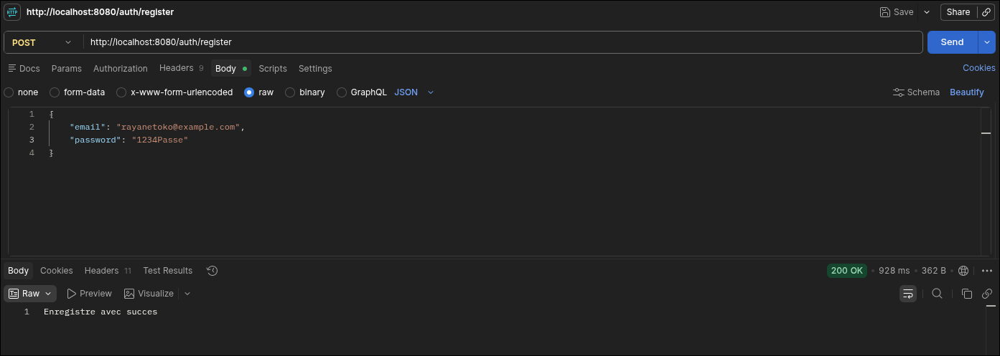

# Atelier Spring Boot Security

## Enregistrement d'un user
- **Route:** `localhost:8080/auth/register`
- **Résultat de la requête**

## Connexion
- **Route:** `localhost:8080/auth/login`
- **Résultat de la requête**
